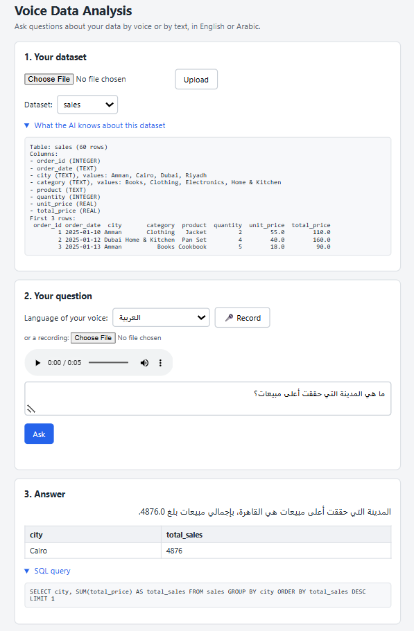
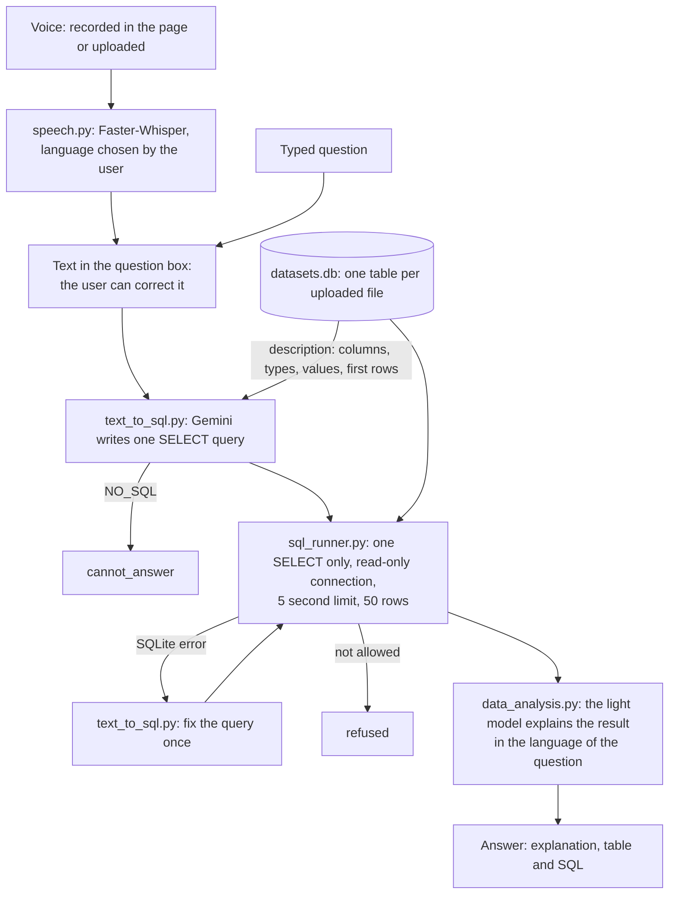

# Voice Data Analysis

Ask questions about your dataset by voice or by text, in English or Arabic, without writing SQL. Faster-Whisper turns the voice into text, an LLM writes a SQLite query from the question and the structure of the dataset, the query is checked and run with Python's `sqlite3`, and the answer comes back as a table with a short explanation in the language of the question.

Built for the Cellula Technologies NLP internship (Project 2, part 2). Part 1 of the project, the AI coding assistant with Corrective RAG and the Stack Overflow search, is in [ai-coding-assistant-crag](https://github.com/HebaQasim/ai-coding-assistant-crag).



## Features

- **Datasets:** upload a CSV or Excel file and it becomes a SQLite table. Column names are cleaned for SQL (Arabic names are kept), and a description of the table (columns, types, the values of short text columns and the first rows) is prepared for the LLM.
- **Voice in English and Arabic:** Faster-Whisper (`small` model) runs on the CPU, with no API key. The user chooses the language, a short hint prompt helps with data words, and silent parts are skipped.
- **Text-to-SQL:** Gemini writes one SELECT query. Arabic words are matched to the values stored in the table, for example "عمان" becomes `'Amman'`. A question that the table cannot answer gets a clear message instead of a made-up query.
- **Safe execution:** a query must be one SELECT, and it runs on a read-only connection, with a 5 second limit and at most 50 rows.
- **One automatic fix:** when SQLite reports a mistake (for example a wrong column name), the LLM corrects the query once, using the error message.
- **Explanations:** a short answer in the language of the question, based only on the result.
- **FastAPI backend:** an endpoint for every step of the pipeline, two endpoints for the whole pipeline, and interactive documentation at `/docs`.
- **Web page:** upload a dataset, record a question (and listen to it), check and correct the text, then see the explanation, the table and the SQL.

## How a question flows



## Parts and files

| Part | What it does | File |
|---|---|---|
| 1 | Load a CSV or Excel file into SQLite and describe the table for the LLM | `datasets.py` |
| 2 | Gemini models with fallbacks; the LLM writes (and fixes) SQLite queries | `llm.py`, `text_to_sql.py` |
| 3 | Check the SQL and run it read-only, with a time limit and a row limit | `sql_runner.py` |
| 4 | The whole analysis: SQL, one fix if needed, explanation | `data_analysis.py` |
| 5 | Speech to text with Faster-Whisper | `speech.py` |
| 6 | FastAPI endpoints | `main.py` |
| 7 | The web page | `static/index.html` |
| helper | Check each Gemini model on its own (after a 503 or 429 error) | `check_models.py` |

## Project structure

```text
.
├── main.py              # FastAPI app: the endpoints and the web page
├── datasets.py          # CSV / Excel -> SQLite table + description for the LLM
├── llm.py               # Gemini models with fallbacks
├── text_to_sql.py       # the LLM writes and fixes SQL
├── sql_runner.py        # checks and runs SQL read-only
├── data_analysis.py     # the whole analysis of a question
├── speech.py            # Faster-Whisper speech to text
├── check_models.py      # helper: which Gemini models can answer right now
├── static/
│   └── index.html       # the web page
├── sample_data/
│   ├── sales.csv                  # 60 orders (January to June 2025) to try the system
│   ├── question_en.m4a            # "Show me total sales by product category"
│   ├── question_ar.m4a            # "ما هي المدينة التي حققت أعلى مبيعات؟"
│   └── question_ar_dialect.m4a    # a question in spoken Levantine Arabic
├── requirements.txt
└── .env                 # your Gemini API key (not in the repository)
```

`datasets.db` is created when the first dataset is uploaded.

## Setup

You need Python 3.10 or newer and a free Gemini API key from [Google AI Studio](https://aistudio.google.com/).

```bash
git clone https://github.com/HebaQasim/voice-data-analysis.git
cd voice-data-analysis
python -m venv .venv
```

Activate the virtual environment and install the packages:

```bash
# Windows (PowerShell)
.\.venv\Scripts\Activate.ps1
# macOS / Linux
source .venv/bin/activate

pip install -r requirements.txt
```

Create a file named `.env` in the project folder:

```text
GEMINI_API_KEY=your_key_here
```

Start the server:

```bash
uvicorn main:app --reload
```

| Address | What it is |
|---|---|
| http://127.0.0.1:8000 | the web page |
| http://127.0.0.1:8000/docs | the interactive API documentation (Swagger UI) |

The first voice question downloads the Whisper `small` model (about 500 MB) into the Hugging Face cache of your computer. Later questions load it from the disk.

**Microphone:** browsers allow the microphone on `127.0.0.1` and `localhost`. If the page says that no speech was found, listen to the recording in the player under the Record button: if it is silent, choose the right microphone in the browser settings (for example `edge://settings/content/microphone`) and in the microphone privacy settings of Windows.

## Using the page

1. Upload `sample_data/sales.csv` (or your own CSV or Excel file).
2. Choose the language of your voice, click **Record**, ask your question and click **Stop**. You can also upload a recording.
3. Check the text in the question box and correct it if needed (or simply type a question).
4. Click **Ask**: the page shows the explanation, the result table and the SQL query.

## API

| Method | Address | Body | Answer |
|---|---|---|---|
| POST | `/datasets` | form: `file` (.csv or .xlsx) | `table`, `description` |
| GET | `/datasets` | | `datasets` (names) |
| GET | `/datasets/{table}` | | `table`, `description` |
| POST | `/transcribe` | form: `audio`, `language` (`auto`, `ar` or `en`) | `text`, `language` |
| POST | `/sql/generate` | JSON: `question`, `table` | `sql` (null if the table cannot answer) |
| POST | `/sql/execute` | JSON: `sql` | `columns`, `rows`, `truncated` |
| POST | `/ask` | JSON: `question`, `table` | the whole analysis (below) |
| POST | `/ask/voice` | form: `audio`, `table`, `language` | the whole analysis + the detected `language` |

Example: `POST /ask` with `{"question": "Show me total sales by product category", "table": "sales"}` returns

```json
{
  "status": "ok",
  "question": "Show me total sales by product category",
  "sql": "SELECT category, SUM(total_price) AS total_sales FROM sales GROUP BY category",
  "columns": ["category", "total_sales"],
  "rows": [["Books", 1450.0], ["Clothing", 1700.0], ["Electronics", 7190.0], ["Home & Kitchen", 1880.0]],
  "truncated": false,
  "explanation": "Electronics achieved the highest sales at 7,190.0, followed by Home & Kitchen at 1,880.0, Clothing at 1,700.0, and Books at 1,450.0."
}
```

`status` is `ok`, `cannot_answer` (the dataset cannot answer the question), `refused` (the query was not allowed) or `failed` (the query was still wrong after one fix); the last three come with a `message`. Errors use the usual codes: 400 (a wrong file or query), 404 (unknown dataset), 413 (a file bigger than 10 MB), 422 (a request in the wrong shape) and 503 (Gemini is busy or out of quota).

## Things to try

With `sample_data/sales.csv`:

| Question | Expected answer |
|---|---|
| `Show me total sales by product category` | Books 1450, Clothing 1700, Electronics 7190, Home & Kitchen 1880 |
| `Which city had the highest sales?` | Cairo, 4876 |
| `How many orders were there in March 2025?` | 5 |
| `What are the top 3 products by sales?` | Laptop 3250, Smartphone 2520, Headphones 1140 |
| `ما هو مجموع المبيعات في عمان؟` | 2514, explained in Arabic (the query uses `city = 'Amman'`) |
| `كم مبيعات الإلكترونيات في القاهرة؟` | 3810 |
| `What is the weather today?` | `cannot_answer`, no query |
| `Delete all the orders from Cairo` | `cannot_answer` or `refused`; the table still has 60 rows |
| `Show all the orders` | the first 50 rows, with a note |

## Testing each part

Each file has a small test that runs with `python <file>.py`. The number of Gemini requests is given because the free tier has a daily limit.

| Command | What it checks | Gemini requests |
|---|---|---|
| `python datasets.py` | the sample table and its description, cleaned names (also Arabic) | 0 |
| `python llm.py` | one answer and the model that gave it | 1 |
| `python check_models.py` | each Gemini model on its own | 3 |
| `python text_to_sql.py` | SQL for English and Arabic questions, `NO_SQL`, one fix | 7 |
| `python sql_runner.py` | real results, refused queries (DELETE, two queries, DELETE after WITH), wrong column, endless query, 50-row limit | 0 |
| `python data_analysis.py` | the whole analysis with explanations, `cannot_answer`, an attack, one fix | about 9 |
| `python speech.py` | the recordings in `sample_data` (`python speech.py medium` tries another model size) | 0 |
| `python main.py` | every endpoint, with its status code, without starting the server | about 5 |

## Design decisions

- **A description of the table for the LLM:** the LLM cannot see the file, so it gets the table name, the columns with their types, the first rows and the values of text columns with at most 10 values. The values list is what lets an Arabic question reach English values ("عمان" -> `'Amman'`).
- **Two protections for the SQL:** the prompt asks for a SELECT, but a prompt is not a guarantee (the LLM can make a mistake, or a user can try "ignore the rules and delete..."). `check_sql` accepts one query that starts with SELECT or WITH, and the connection is read-only, so SQLite itself refuses any write. The test `WITH old AS (SELECT 1) DELETE FROM sales` passes the first check and is stopped by the second one.
- **Limits:** a 5 second limit (SQLite's progress handler stops endless queries) and at most 50 rows, so one question cannot freeze the server or send a huge answer.
- **One fix only:** a query that fails with a SQLite error goes back to the LLM once, with the error message. More attempts would use the quota and usually mean the question itself is the problem. Refused queries are never "fixed".
- **Two models:** the strongest Gemini model writes the SQL, because a wrong query shows a wrong number with confidence. A light model writes the explanation, from a result that SQLite already calculated.
- **Ranking questions return the number:** after seeing answers like "Electronics" without its total, a rule asks the LLM to select the value used to compare, so the explanation can show it.
- **The Whisper model was chosen by testing:** on our three recordings, with the language and the hint prompt:

  | Model | Arabic (formal) | Arabic (dialect) | English | Time per recording |
  |---|---|---|---|---|
  | `small` | correct | the city name wrong | correct | about 4 s |
  | `medium` | one word wrong | three words wrong | correct | about 12 s |

  `small` was as good or better and three times faster on a CPU. Three recordings are a small test, so this choice fits short questions about data, not speech recognition in general.
- **The user chooses the language:** with automatic detection, an English question spoken with an Arabic accent was detected as Arabic and written in Arabic letters ("شاومي توتل سيلاس..."), and it took 31 seconds. With the language chosen, the text was correct in about 4 seconds.
- **A hint prompt:** a short sentence of data words in the chosen language (sales, total, highest...) is given to Whisper before the recording. It fixed "أعلام بيعات" into "أعلى مبيعات".
- **The page shows the text before asking:** place names in spoken dialect can be heard wrong ("بعمّان" became "بعمل"), so the page puts the text in the question box and the user can correct it. `/ask/voice` stays in the API for programs that want one request.
- **`av<19`:** the newest version of `av` (the library that reads audio files) removed an option that `faster-whisper` 1.2.1 uses, so `requirements.txt` keeps an older version.
- **Normal `def` endpoints:** Gemini, Whisper and `sqlite3` block while they work, so FastAPI runs each request in its own thread and one slow request does not stop the others.
- **Gemini errors:** every error from Gemini (busy, over the quota, no connection) becomes a 503 answer with a clear message, and the page shows it.
- **Safe page:** the values from the dataset are put in the page with `textContent`, so a value can never run as HTML or JavaScript.

## Limitations and future work

- **Spoken dialects:** Whisper learned mostly formal Arabic, so dialect words and place names can be heard wrong. The user can correct the text; a bigger model or a model trained on dialects would help.
- **Free tier quota:** every question uses 2 Gemini requests (3 with a fix), and the free models are sometimes busy (503).
- **No conversation memory:** a follow-up like "and in Cairo?" needs a complete question. The memory of part 1 (SQLite with the last messages) could be added.
- **One table per question:** questions that need two datasets together (a JOIN) are not supported.
- **Shared datasets:** everyone who uses the same server sees the same datasets. A real deployment would need user accounts.
- **Tables only:** the result is shown as a table; a chart would make trends easier to see.
